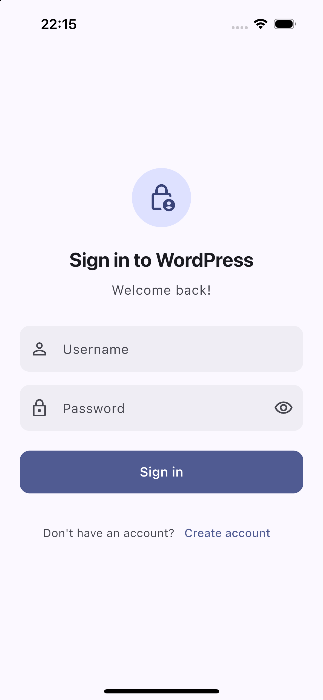
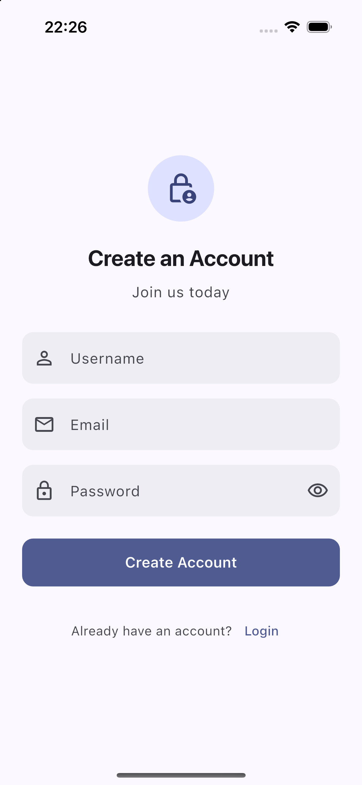
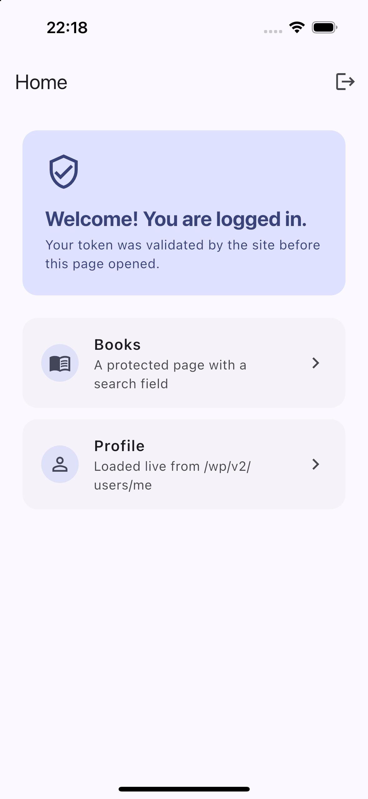
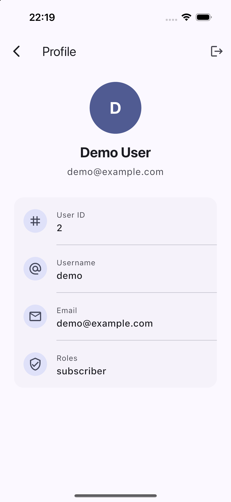
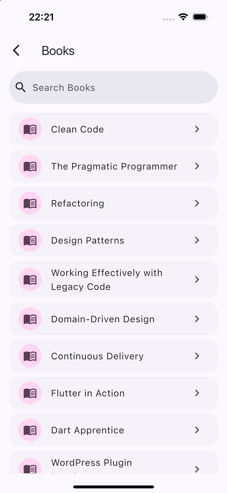
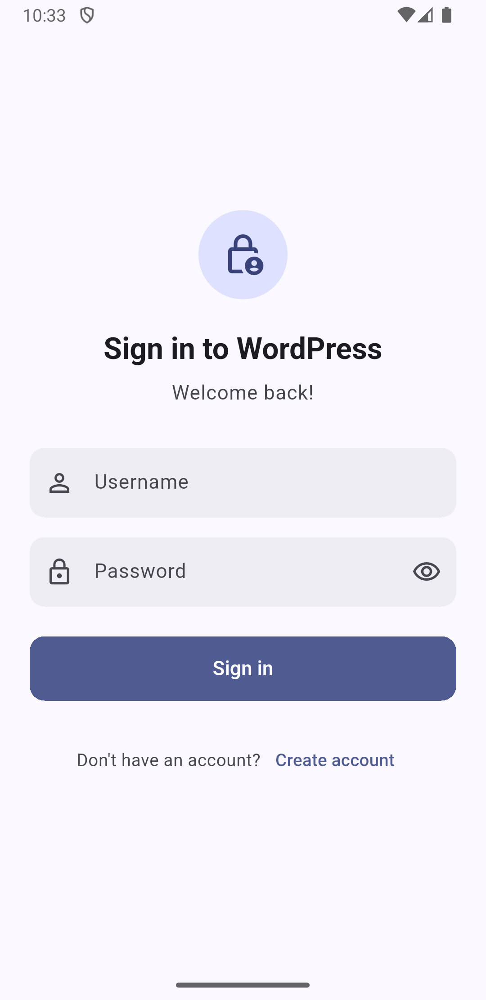
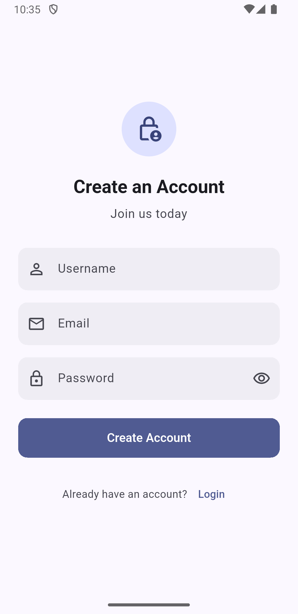
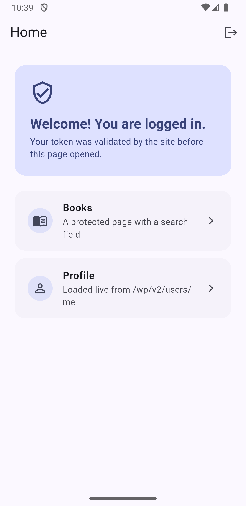
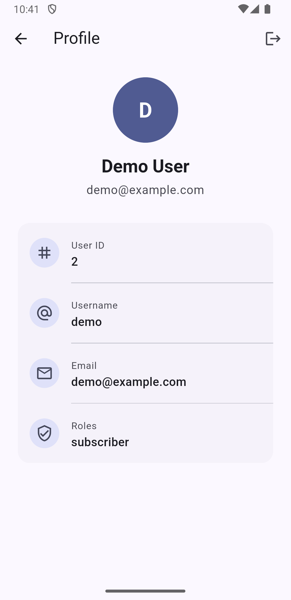
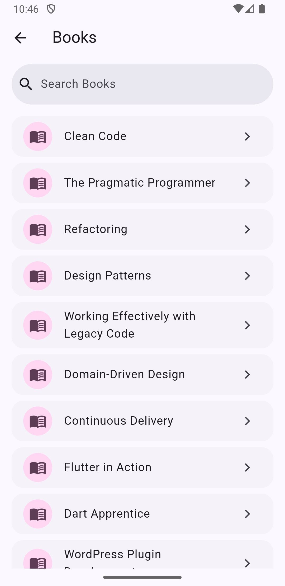

# wordpress_jwt_auth

[](https://pub.dev/packages/wordpress_jwt_auth)
[](https://github.com/nurullahturkoglu/wordpress_jwt_auth/actions/workflows/ci.yml)
[](LICENSE)

A Dart client for the [JWT Authentication for WP REST API](https://wordpress.org/plugins/jwt-authentication-for-wp-rest-api/) WordPress plugin. It logs users in, validates stored tokens, loads the current user and turns the plugin's error responses into typed Dart exceptions. The `example/` folder contains a Flutter app with login, registration and protected pages.

The package is pure Dart, so it also works in command line tools and on the server. Token storage is an interface; the example app implements it with `flutter_secure_storage`.

## Features

- `login()` against `POST /wp-json/jwt-auth/v1/token`, token is stored for you
- `validateToken()` against `POST /wp-json/jwt-auth/v1/token/validate`, rejected tokens are cleared
- `currentUser()` reads id, username, email and roles from `GET /wp-json/wp/v2/users/me`, no plugin modification needed
- `JwtClaims` decodes the token locally, so expiry and the user ID are available without a request
- Sealed exception hierarchy: wrong credentials, invalid or expired token, missing server configuration, registration errors, network errors
- WordPress error messages arrive with HTML; the package strips it
- `JwtAuthInterceptor` adds the `Authorization: Bearer` header to any Dio instance
- Optional `register()` backed by a small WordPress plugin included in this repository
- Light and dark theme example app with widget tests, plus a Docker setup for a local WordPress

## Screenshots

Captured against the Docker WordPress described below, with `docker/screenshots.sh`. iPhone 15 Pro simulator on top, Pixel 3a emulator (API 34) below.

| Login | Register | Home | Profile | Books |
| --- | --- | --- | --- | --- |
|  |  |  |  |  |
|  |  |  |  |  |

## Prerequisites

- Dart SDK 3.8 or newer. For the example app, Flutter 3.32 or newer
- A WordPress site, 4.7 or newer, with pretty permalinks enabled
- The [JWT Authentication for WP REST API](https://wordpress.org/plugins/jwt-authentication-for-wp-rest-api/) plugin, 1.3 or newer
- For the example app: Android Studio or Xcode, and Docker if you want the local WordPress

## WordPress Setup

### Step 1: Install the plugin

Install and activate **JWT Authentication for WP REST API** from the WordPress plugin directory, or with WP-CLI:

```bash
wp plugin install jwt-authentication-for-wp-rest-api --activate
```

### Step 2: Add the secret key

Add the following to `wp-config.php`, above the line that says `/* That's all, stop editing! */`. Use a long random value; the WordPress [salt generator](https://api.wordpress.org/secret-key/1.1/salt/) is a good source.

```php
define('JWT_AUTH_SECRET_KEY', 'your-long-random-secret');
```

If you call the API from a browser (Flutter web), also enable CORS:

```php
define('JWT_AUTH_CORS_ENABLE', true);
```

### Step 3: Pass the Authorization header to PHP

Many shared hosts drop the `Authorization` header before it reaches WordPress. Add this to the `.htaccess` file in the WordPress root, before the `# BEGIN WordPress` block:

```apache
RewriteEngine on
RewriteCond %{HTTP:Authorization} ^(.*)
RewriteRule ^(.*) - [E=HTTP_AUTHORIZATION:%1]
```

On WP Engine use this instead:

```apache
SetEnvIf Authorization "(.*)" HTTP_AUTHORIZATION=$1
```

### Step 4: Optional, enable registration

The plugin has no registration endpoint and WordPress core only lets administrators create users over the REST API. If your app needs sign up, copy [`wordpress/jwt-auth-register.php`](wordpress/jwt-auth-register.php) into `wp-content/plugins/jwt-auth-register/` and activate it. It adds `POST /wp-json/jwt-auth/v1/register`, honours the **Anyone can register** setting under Settings → General, and creates users with the site's default role.

### Step 5: Check the endpoints

```bash
curl -X POST https://example.com/wp-json/jwt-auth/v1/token \
  -H 'Content-Type: application/json' \
  -d '{"username":"demo","password":"secret"}'
```

A working site answers with a `token` field. See [Troubleshooting](#troubleshooting) if it does not.

## Getting Started

### Using the package

Add the dependency:

```bash
dart pub add wordpress_jwt_auth
```

Log in and read the current user:

```dart
import 'package:wordpress_jwt_auth/wordpress_jwt_auth.dart';

final auth = WordPressJwtAuth(baseUrl: 'https://example.com');

final response = await auth.login(username: 'demo', password: 'secret');
print(response.userDisplayName);
print(response.claims?.expiresAt);

final user = await auth.currentUser();
print('${user.id} ${user.username} ${user.roles}');
```

Handle errors with an exhaustive `switch`:

```dart
try {
  await auth.login(username: username, password: password);
} on JwtAuthException catch (e) {
  final text = switch (e) {
    InvalidCredentialsException() => 'Wrong username or password',
    InvalidTokenException() => 'Session expired',
    ServerConfigurationException() => 'The site is not set up for JWT (${e.code})',
    RegistrationException() => e.message,
    NetworkException() => 'Could not reach the site',
    UnexpectedResponseException() => 'Unexpected response',
  };
}
```

Check the stored token when the app starts:

```dart
final claims = await auth.claims();
if (claims == null || claims.isExpired) {
  // go to login
} else if (await auth.validateToken()) {
  // go to home
}
```

`validateToken()` throws `NetworkException` when the site is unreachable and keeps the token, so an offline app can decide what to do.

Call other REST endpoints with the same token:

```dart
final dio = Dio(BaseOptions(baseUrl: 'https://example.com/wp-json/'))
  ..interceptors.add(JwtAuthInterceptor(auth.storage));

final posts = await dio.get('wp/v2/posts');
```

Keep the token across restarts by implementing `TokenStorage`. The example app does it with `flutter_secure_storage`:

```dart
class SecureTokenStorage implements TokenStorage {
  final _storage = const FlutterSecureStorage();

  @override
  Future<String?> read() => _storage.read(key: 'wordpress_jwt');

  @override
  Future<void> write(String token) => _storage.write(key: 'wordpress_jwt', value: token);

  @override
  Future<void> delete() => _storage.delete(key: 'wordpress_jwt');
}

final auth = WordPressJwtAuth(
  baseUrl: 'https://example.com',
  storage: SecureTokenStorage(),
);
```

Register a user through the endpoint from step 4:

```dart
final auth = WordPressJwtAuth(baseUrl: 'https://example.com', registerPath: 'register');
final result = await auth.register(
  username: 'newuser',
  email: 'newuser@example.com',
  password: 'secret',
);
```

### Running the example app

1. Clone the repository:

   ```bash
   git clone https://github.com/nurullahturkoglu/wordpress_jwt_auth.git
   cd wordpress_jwt_auth/example
   ```

2. Install dependencies:

   ```bash
   flutter pub get
   ```

3. Run against your site. The URL is passed at build time:

   ```bash
   flutter run --dart-define=WP_BASE_URL=https://example.com
   ```

### Local WordPress with Docker

The `docker/` folder starts WordPress, MariaDB and WP-CLI, installs the JWT plugin and the register plugin, enables registration and creates a demo user.

1. Start it:

   ```bash
   ./docker/setup.sh
   ```

   The site is at http://localhost:8080 with `admin` / `admin` and `demo` / `demo1234`.

2. Run the app:

   ```bash
   cd example
   flutter run -d "iPhone 15 Pro" --dart-define=WP_BASE_URL=http://localhost:8080
   flutter run -d emulator-5554 --dart-define=WP_BASE_URL=http://10.0.2.2:8080
   ```

   The Android emulator reaches the host machine through `10.0.2.2`. Plain `http` is allowed in debug builds only, see [Configuration](#configuration).

3. Stop it with `docker compose -f docker/docker-compose.yml down`. Add `-v` to delete the database as well.

## Configuration

| Setting | Where | Default |
| --- | --- | --- |
| Site URL | `--dart-define=WP_BASE_URL=...` read in `example/lib/config.dart` | `http://localhost:8080` |
| Register endpoint path | `AppConfig.registerPath` | `register` |
| JWT secret and CORS | `wp-config.php` on the site | none |
| Token lifetime | `jwt_auth_expire` filter on the site | 7 days |

Plain `http` for local development is enabled by `android:usesCleartextTraffic="true"` in `example/android/app/src/debug/AndroidManifest.xml` and `NSAllowsLocalNetworking` in `example/ios/Runner/Info.plist`. Release builds keep the platform defaults and require `https`.

## Project Structure

```
.
├── lib/
│   ├── wordpress_jwt_auth.dart          # public exports
│   └── src/
│       ├── wordpress_jwt_auth_client.dart  # WordPressJwtAuth
│       ├── exceptions.dart              # JwtAuthException and subclasses
│       ├── jwt_auth_interceptor.dart    # bearer header for Dio
│       ├── token_storage.dart           # TokenStorage, InMemoryTokenStorage
│       └── models/                      # TokenResponse, JwtClaims, WordPressUser, RegistrationResult
├── test/                                # unit tests with a scripted HttpClientAdapter
├── example/
│   ├── lib/
│   │   ├── main.dart                    # app, routes, theme
│   │   ├── config.dart                  # WP_BASE_URL
│   │   ├── pages/view/                  # login, register, home, profile, books
│   │   ├── services/secure_token_storage.dart
│   │   └── widgets/                     # AuthGate, AuthScope, shared form widgets
│   └── test/app_test.dart               # widget tests
├── wordpress/jwt-auth-register.php      # optional register endpoint
├── docker/                              # local WordPress for development
└── screenshots/
```

## Troubleshooting

**`ServerConfigurationException` with code `rest_no_route`**
The plugin is not active, or pretty permalinks are off. Enable any permalink structure other than "Plain" under Settings → Permalinks and save once.

**`ServerConfigurationException` with code `jwt_auth_bad_config`**
`JWT_AUTH_SECRET_KEY` is missing from `wp-config.php`.

**Login works but every other call returns 401 `rest_not_logged_in`**
The `Authorization` header is dropped before it reaches PHP. Apply step 3 of the WordPress setup. On nginx with PHP-FPM make sure `fastcgi_param HTTP_AUTHORIZATION $http_authorization;` is set.

**`InvalidTokenException` right after login**
The site URL in the token (`iss`) must match the WordPress address under Settings → General. This happens when the site is served from more than one domain, or when `WP_HOME` differs from `siteurl`.

**CORS errors on Flutter web**
Define `JWT_AUTH_CORS_ENABLE` in `wp-config.php`. If the browser still complains, use the plugin's `jwt_auth_cors_allow_headers` filter or configure CORS in the web server.

**iOS: "App Transport Security has blocked a cleartext HTTP"**
ATS allows only `https`. The example app enables `NSAllowsLocalNetworking` for `localhost`. For any other `http` address, use `https` or add a temporary exception in `Info.plist` for development only.

**Android emulator cannot reach `localhost`**
Use `10.0.2.2` instead, it maps to the host machine.

**Tokens never expire or expire too soon**
The lifetime is set by the site with the `jwt_auth_expire` filter, 7 days by default. The free plugin has no refresh endpoint; ask the user to log in again when `JwtClaims.isExpired` is true.

## License

MIT, see [LICENSE](LICENSE).

## Contributing

Bug reports and pull requests are welcome. Run `dart test` in the root and `flutter test` in `example/` before opening a PR. The CI runs format, analyze and tests for both, plus Android and iOS builds.

## Security Notes

- Never commit `JWT_AUTH_SECRET_KEY`. Rotate it if it leaks; all existing tokens become invalid.
- Use `https` in production. Tokens travel in the `Authorization` header on every request.
- Store tokens with `flutter_secure_storage` or an equivalent, not in `shared_preferences`.
- `JwtClaims` only decodes the token. It does not verify the signature; the site does that.
- The free plugin cannot revoke tokens. `logout()` only forgets the token on the device. Keep the lifetime short with the `jwt_auth_expire` filter if that matters to you.
- The register endpoint is public by design. Keep **Anyone can register** off unless you need it, and consider rate limiting or a captcha in front of it.
